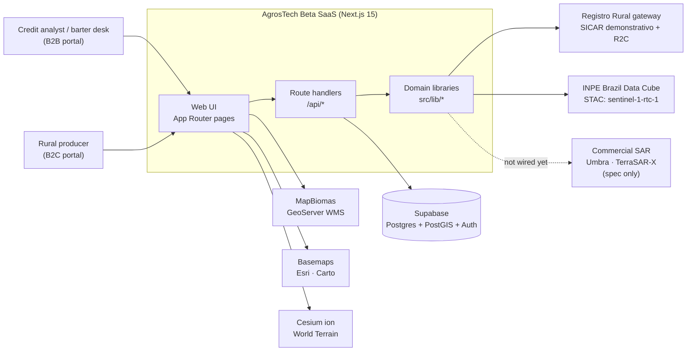
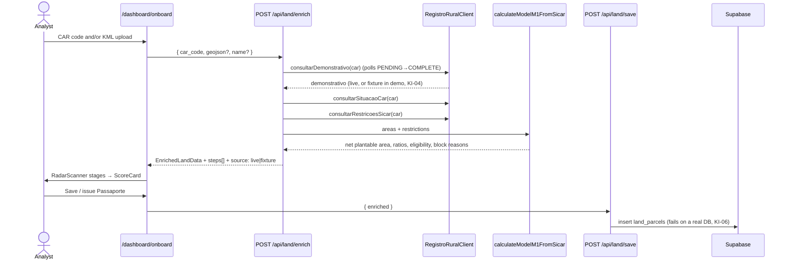
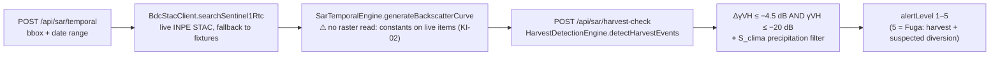

# Architecture

> Status: describes the code at handover (2026-10-03). Where the code differs from the intended design, this document says so and links to [`KNOWN_ISSUES.md`](../05-quality/KNOWN_ISSUES.md).

## 1. System context



## 2. Layers and where things live

```
src/
├── app/                      # Next.js App Router: pages and API route handlers
│   ├── page.tsx              # redirects to /dashboard (middleware sends anonymous users to /login)
│   ├── login/                # demo portal picker (B2B / B2C) + Supabase login form
│   ├── dashboard/
│   │   ├── page.tsx          # portfolio: Sidebar + 2D map (MapView2D)
│   │   ├── onboard/          # 3-step wizard: Entrada → Radar → Dossiê
│   │   ├── shield-rj/        # fraud war room (graph, timeline, evidence, petition)
│   │   └── land/[id]/3d/     # 3D digital twin (CesiumViewer)
│   └── api/
│       ├── land/enrich       # CAR → SICAR + R2C + M1 → EnrichedLandData
│       ├── land/save         # persist parcel to Supabase
│       ├── sar/temporal      # STAC search → backscatter curve
│       ├── sar/harvest-check # backscatter series → M2 harvest verdict
│       ├── sar/commercial/task  # commercial SAR tasking orders (in-memory)
│       └── dossier/generate  # MCR 2-9 dossier as JSON or PDF
├── components/
│   ├── layout/               # AppShell, Header, Sidebar
│   ├── map/                  # MapView2D, MiniMap, CesiumViewer, MapBiomas cards
│   ├── wizard/               # KmlUploader, RadarScanner, ScoreCard (used)
│   ├── dashboard/            # DemoBadge, ScoreCard (unused duplicate, KI-42)
│   ├── shield-rj/            # GraphVisualizer, RedFlagTimeline, EvidenceAuditTable, StrikeModal
│   ├── theme/                # ThemeProvider, ThemeToggle (light/dark via CSS vars)
│   └── ui/                   # Badge, Button, Card, Logo
├── lib/                      # framework-free domain logic (tested)
│   ├── registrorural/        # gateway client, diagnostic errors, offline fixtures
│   ├── m1/                   # Model M1 net plantable area + polygon hole-punching
│   ├── sar/                  # BDC STAC client, temporal engine, M2 harvest engine
│   │   └── commercial/       # Zod schemas, Umbra/TSX adapters, order state machine
│   ├── dossier/              # MCR 2-9 generator, PDF writer, types
│   ├── supabase/             # browser/server clients, session middleware, API auth guard
│   ├── mapbiomas.ts          # MapBiomas themes, WMS URL builder, Alerta GraphQL
│   ├── kmlParser.ts          # KML → GeoJSON (@tmcw/togeojson)
│   ├── spatialUtils.ts       # area (ha), bbox, centroid
│   ├── format.ts             # pt-BR number, ha, currency, sacas formatting
│   └── mockData.ts           # demo portfolio, Buritis geometry, Shield-RJ scenario
├── middleware.ts             # auth gate for /dashboard/* and /api/*
└── types/                    # database.ts (DB rows), geospatial.ts, sar.ts
```

**Design rule:** keep `src/lib/*` free of React and Next imports. It is the part that is unit-tested (`tests/e2e/`) and the part most likely to move into a separate service later (SAR processing especially; see [ADR-0005](../adr/0005-dual-track-sar.md)).

## 3. Key flows

### 3.1 Land onboarding (CAR → Passaporte)



### 3.2 SAR monitoring (M2 Anti-Fuga)



Commercial high-resolution track: `POST /api/sar/commercial/task` validates an Umbra or TerraSAR-X request with Zod, builds a provider payload and stores the order in an in-memory state machine (starts at `SUBMITTED`; see `stateMachine.ts` for transitions). Nothing is sent to the providers (KI-08).

### 3.3 MCR 2-9 dossier

`POST /api/dossier/generate[?format=pdf]` → `Mcr29DossierGenerator.generateDossier` runs these checks:
- SICAR status
- embargo
- indigenous land (TI) / conservation unit (UC) overlap
- slave-labour list
- net arable ratio ≥ 15 %
- the >300 ha continuous-monitoring flag

It then builds a canonical payload, hashes it with SHA-256 and attaches **placeholder** PAdES/RFC 3161 metadata (KI-01). `pdfGenerator.ts` writes a minimal PDF-1.4 by hand, with no dependency. The `X-Dossier-SHA256` and `X-MCR29-Status` response headers carry the hash and verdict.

### 3.4 3D digital twin

See [`DIGITAL_TWIN_3D.md`](./DIGITAL_TWIN_3D.md).

## 4. Runtime modes

Two independent switches decide how "real" a running instance is:

| Variable | `true` / `demo` | `false` / `production` |
|---|---|---|
| `NEXT_PUBLIC_DEMO_MODE` | Login by portal cookie (no password); "Dados de Demonstração" badge shown | Supabase Auth session required; badge hidden |
| `INTEGRITY_MODE` (+ `ALLOW_MOCK_FALLBACK`) | Registro Rural client serves offline fixtures when there is no key or the gateway is down | Missing or invalid key raises `CONFIG_MISSING_API_KEY` / `AUTH_UNAUTHORIZED` (but see KI-04) |

The BDC STAC client always falls back to fixtures when live search fails or returns nothing (`enableOfflineFallback` defaults to `true`).

## 5. Rendering and client/server split

- **Pages** are client components (`"use client"`) that call the route handlers with `fetch`. There are no Server Actions.
- **Heavy map libraries** (MapLibre, Deck.gl, Cesium) are loaded with `next/dynamic` and `ssr: false`.
- **Cesium static assets** (Workers, Assets, Widgets, ThirdParty) are served from `/cesium/`. They are copied from `node_modules` at install, dev and build time ([ADR-0004](../adr/0004-cesium-assets-copied-at-install.md)).
- **Theme**: Tailwind colours point at CSS variables in `globals.css`, so light and dark mode work on every page. The UI language is **pt-BR**.

## 6. Cross-cutting concerns

| Concern | Today | Target |
|---|---|---|
| AuthN | Supabase SSR session, or demo cookie | Supabase only in prod |
| AuthZ | None beyond "is authenticated" | Role (`b2c`/`b2b_admin`/`b2b_viewer`) + org-scoped RLS |
| Validation | Zod on commercial SAR; hand-written checks elsewhere | Zod at every API boundary |
| Errors | `RegistroRuralError` diagnostic codes → HTTP status; inline UI banners | Same, plus error tracking |
| Observability | `console.*` | Structured logs, Sentry/OTel |
| Persistence | Mock data; one insert path | Repositories over Supabase |

## 7. Related documents

- [API reference](./API_REFERENCE.md) · [Data model](./DATA_MODEL.md) · [3D digital twin](./DIGITAL_TWIN_3D.md)
- [Domain models M1 / M2 / Shield-RJ / Dossier](../03-domain-models/)
- [Architecture Decision Records](../adr/)
