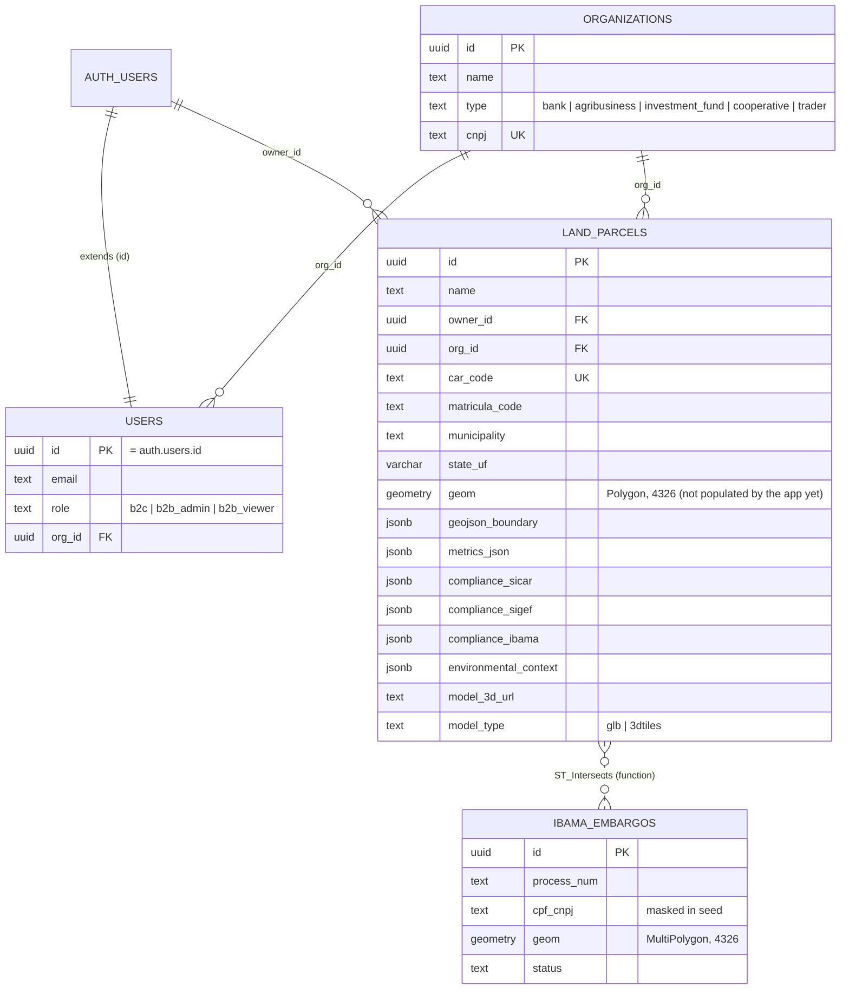

# Data Model

**Source of truth:** [`supabase/schema.sql`](../../supabase/schema.sql) (DDL + RLS) and [`supabase/seed.sql`](../../supabase/seed.sql) (demo rows). The TypeScript mirror is in `src/types/database.ts`.

> **Today the app does not read from this database.** Every screen renders `src/lib/mockData.ts` (KI-07), and the one write path fails against a real DB (KI-06). Treat this schema as the reviewed starting point, not a production schema.

## Entity diagram

## Tables

| Table | Purpose | Notes |
|---|---|---|
| `organizations` | B2B tenants (bank, agribusiness, fund, cooperative, trader) | `cnpj` is unique |
| `users` | Profile extending `auth.users`, with role and org | No insert trigger on sign-up yet; profiles must be created explicitly |
| `land_parcels` | The core asset: cadastral codes, PostGIS boundary, compliance JSON, 3D twin pointer | GIST index on `geom`; indexes on owner, org and CAR |
| `ibama_embargos` | Local copy of IBAMA embargo polygons for spatial checks | Seeded with 2 synthetic polygons near Buritis |

**Function:** `public.check_ibama_intersection(parcel_geometry geometry)` returns `(is_embargoed, embargo_count, records jsonb)` with the intersection area in ha. It is not called by the app yet.

## Row-Level Security

RLS is enabled on all four tables.

| Table | Read | Write |
|---|---|---|
| `organizations` | Members of the org | none |
| `users` | Self, plus colleagues in the same org | Self (update) |
| `land_parcels` | Owner, plus any member of the parcel's org | Insert, update and delete: owner, or a `b2b_admin` of the org |
| `ibama_embargos` | Any authenticated user | none (service role only) |

### ⚠️ Review before first real deployment

1. **Recursive policies.** The `users` SELECT policy queries `public.users` inside its own `USING` clause, and the `land_parcels` policies query `public.users` too. In Postgres this usually fails with `infinite recursion detected in policy for relation "users"`. The standard fix is a `SECURITY DEFINER` helper such as `public.current_org_id()` / `public.current_role()` with `SET search_path = public`, used by every policy.
2. **`SECURITY DEFINER` without `search_path`.** `check_ibama_intersection` should `SET search_path = public, extensions`. The Supabase linter flags this.
3. **`b2b_viewer` can read but has no write path.** This is intended, but no API enforces it yet (KI-05).
4. **`updated_at`** has no trigger, so it never changes after insert.
5. **`geom` vs `geojson_boundary`** duplicate each other. Pick one source of truth: populate `geom` from GeoJSON in a trigger or generated column, and use `geom` for spatial queries.

## JSON payload shapes

The JSONB columns hold these TypeScript interfaces (`src/types/database.ts`):

| Column | Interface | Key fields |
|---|---|---|
| `metrics_json` | `LandParcelMetrics` | `total_area_ha`, `app_area_ha`, `legal_reserve_area_ha`, `consolidated_area_ha` (M1 net), `slope_avg_percent`, elevation, `carbon_stock_tco2e` |
| `compliance_sicar` | `ComplianceSicar` | `status`, `has_app`, `legal_reserve_deficit_ha`, `car_overlap_detected`, `last_sync` |
| `compliance_sigef` | `ComplianceSigef` | `certified`, `code`, `tenure_status`, `technical_responsible` |
| `compliance_ibama` | `ComplianceIbama` | `is_embargoed`, `embargos_count`, `records[]` |
| `environmental_context` | `EnvironmentalContext` | `biome`, `watershed`, `soil_type`, `indigenous_overlap`, `conservation_unit_overlap` |

## Tables the product will need next

None of these exist yet. They are listed so the first migration PRs have a shared target.

| Table | Why |
|---|---|
| `sar_acquisitions` / `sar_observations` | Per-parcel γ⁰ VV/VH time series (one row per acquisition × parcel), so M2 has history |
| `harvest_events` | M2 outputs with alert level, confidence and evidence links |
| `dossiers` | Issued MCR 2-9 reports: payload hash, PDF object key, signature status, issuer |
| `commercial_tasking_orders` | Replace the in-memory map (KI-08) |
| `shield_cases`, `case_entities`, `case_events` | Persist Shield-RJ investigations instead of `mockData.ts` |
| `twin_assets` | GLB / 3D Tiles / orthomosaic / DEM per parcel, with capture date and CRS |
| `audit_log` | Who saw or exported what. Banks will ask, and LGPD needs it. |

## Migrations

There is no migration tool configured. Recommended: adopt the **Supabase CLI** (`supabase/migrations/<timestamp>_*.sql`), make the current `schema.sql` the baseline migration, and run `supabase db lint` in CI.
