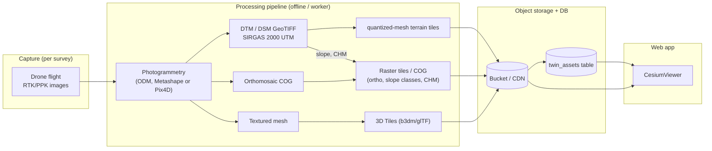

# 3D Digital Twin of the Land (Gêmeo Digital 3D)

The twin is the visual and evidential layer of the product. It ties a credit operation to the physical terrain, including relief, slope, boundaries and drone imagery, so an analyst can see *why* a gross area is not a plantable area.

- **Vision:** [`docs/strategy/IP_MODELS_AND_3D_DIGITAL_TWIN_THESIS.md`](../strategy/IP_MODELS_AND_3D_DIGITAL_TWIN_THESIS.md) §6–§7.
- **Implementation:** `src/components/map/CesiumViewer.tsx`, mounted by `src/app/dashboard/land/[id]/3d/page.tsx`.

## 1. What is implemented today

| Element | Implementation |
|---|---|
| Route | `/dashboard/land/[id]/3d`. The id must match a parcel in `mockData.ts` `ALL_PARCELS`, otherwise the page calls `notFound()`. The demo parcel is `buritis-gleba-sede`. |
| Engine | CesiumJS (resolves to 1.145), loaded client-side only (`next/dynamic`, `ssr: false`) |
| Static assets | `/cesium/{Workers,Assets,Widgets,ThirdParty}`, copied from `node_modules` at install time ([ADR-0004](../adr/0004-cesium-assets-copied-at-install.md)) |
| Terrain | Cesium **World Terrain** (water mask + vertex normals) **only if** `NEXT_PUBLIC_CESIUM_ION_TOKEN` is set. Without it: the WGS84 ellipsoid (flat). |
| Imagery | Cesium's default base layer, which is ion-backed (KI-33) |
| Cadastral prism | The parcel boundary is extruded 0 → 120 m as a translucent lime polygon with an outline |
| 3D asset | `parcel.model_type` decides: `3dtiles` → `Cesium3DTileset.fromUrl(model_3d_url)`; `glb` → a model entity placed at the parcel centroid (250 m). Load failures set a "Modelo 3D indisponível" notice. URLs containing `vercel.app` are skipped on purpose. |
| Camera presets | `drone` (oblique 35°), `nadir` (top-down), `orbit` (low flyby). There is also a live altitude readout. ⚠️ The automatic fly-in on load does not fire, so the user must click a preset first (KI-43). |
| Theme | Dark globe base colour and lighting enabled |

The 2D counterpart (`MapView2D.tsx`) carries the analytical layers: Esri World Imagery, MapBiomas Coleção 9 WMS themes, APP / Reserva Legal / embargo vectors and SAR heat styling. The 3D view does not have these layers yet.

## 2. Gap between the thesis and the code

| Thesis capability (§6) | Status | Notes |
|---|---|---|
| Drone photogrammetry mesh fused with an INPE/SRTM DEM, SIRGAS 2000 / UTM 23S | ❌ Not in the app | Buritis survey products exist outside this repo (drone orthomosaic, 1 m/px DTM, slope maps). Ask the founders for the asset location. |
| Heightfield 356 × 520 (≈7.2 m cells), relief 563–922 m | ❌ | The app uses global World Terrain, not the survey DTM |
| Orthomosaic draped as texture | ❌ | Would be an imagery layer (COG → tiles) |
| EMBRAPA slope-class heatmap draped on terrain | ❌ | Slope classes exist in the Buritis report only |
| 120 m extruded boundary prism | ✅ | |
| Canopy Height Model (DSM − DTM) → biomass → tCO₂e | ❌ | `carbon_stock_tco2e` is currently `area × 65.7` (KI-03) |
| GPS EXIF flight pins | ❌ | |
| Georeferenced GLB placement | ⚠️ | The GLB is placed at a centroid point with no model matrix or height reference, so it will not register to the terrain |

There is also an **external** 3D twin app at `dashboard-ui-liart-ten.vercel.app`. The Sidebar still links to it (KI-41) and its source is not in this repo. The founders should say whether it contains the real Buritis photogrammetric twin.

## 3. Target architecture (recommendation)

### Key decisions to make

1. **Terrain:** keep World Terrain for context, and overlay a survey-specific terrain only inside the parcel? Or stream your own quantized-mesh? (Cesium ion can host either. Self-hosting needs a tiler such as `cesium-terrain-builder` or `ctod`.)
2. **Hosting:** Cesium ion (quick, metered) or your own bucket + CDN (cheaper at scale, more work). Store asset metadata in a `twin_assets` table ([DATA_MODEL.md](./DATA_MODEL.md)).
3. **CRS discipline:** surveys are delivered in SIRGAS 2000 / UTM 23S (EPSG:31983). Everything streamed to Cesium must be ECEF / WGS84, so reproject in the pipeline, never in the browser. Record the vertical datum (geoid vs ellipsoid). A wrong datum is the most common cause of a model "floating" above or sinking below terrain.
4. **Evidence chain:** each twin asset should carry its capture date, operator (ANAC/DECEA authorization reference), processing parameters and a content hash, so the twin can back a dossier.

## 4. Operating notes

- Without `NEXT_PUBLIC_CESIUM_ION_TOKEN` the globe has no terrain and the default imagery may fail to load. Use a token in every environment where the 3D view is demoed.
- Restrict ion tokens to allowed URLs in the ion dashboard.
- Cesium is heavy. Keep it behind `next/dynamic`, and never import `cesium` from a server component.
- When upgrading Cesium, run `npm install`. The postinstall script re-copies the matching Workers and Assets.
